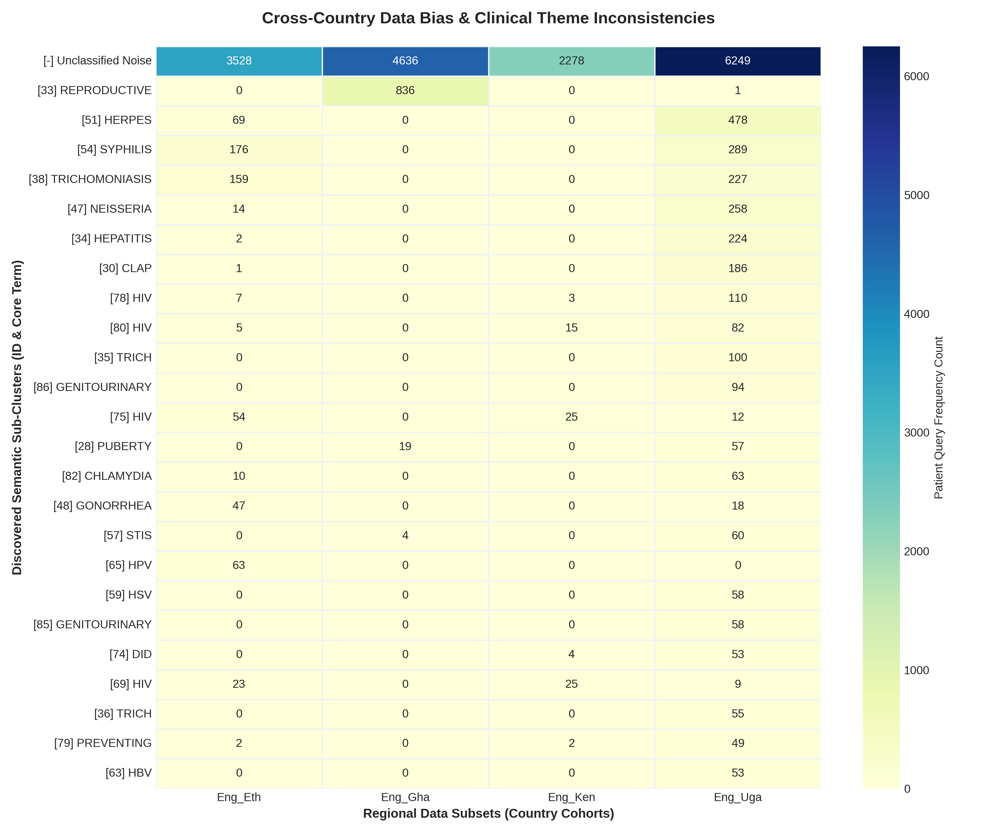
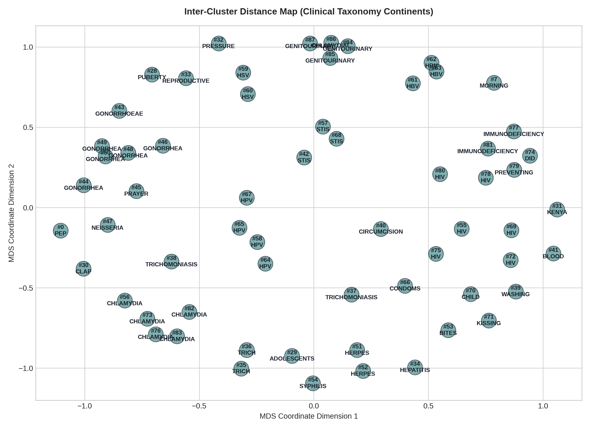
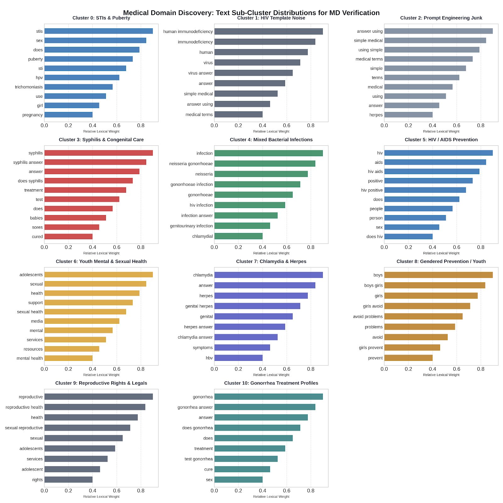
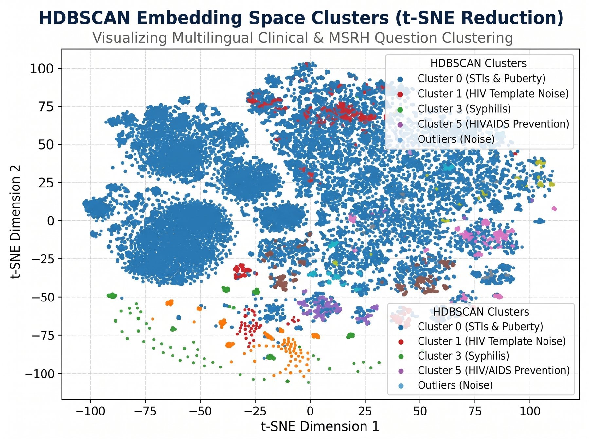

# Multilingual Health QA in Low-Resource African Languages

COMP_URL="https://zindi.world/competitions/multilingual-health-question-answering-in-low-resource-african-languages-challenge"

Retrieval baselines + fine-tuned mT5-large for the **Zindi African Languages Health QA Challenge** (sexual & reproductive health, HIV and STIs; 8 language/country subsets).

> **Result:** 176th of 583 active participants (1,666 joined), roughly the top 30% · Bronze medal · Public score **0.5647** · Private score **0.5730** ·  
> **Built under constraints:** Kaggle free tier, overnight runs, no native speakers on the team.

| Metric (final submission) | Public | Private |
|---|---|---|
| Overall score | 0.5647 | 0.5730 |
| ROUGE-L F1 | 0.4718 | 0.4825 |
| ROUGE-1 F1 | 0.5469 | 0.5587 |
| LLM judge | 0.7222 | 0.7222 |

---

## The problem
Answer health questions in Amharic, Akan, Luganda, Swahili and four English variants (Ethiopia, Ghana, Kenya, Uganda). Scored by Zindi as 0.37 × ROUGE-1 F1 + 0.37 × ROUGE-L F1 + 0.26 × LLM-as-a-judge (1-5, normalised). Answers must be fluent **and** clinically safe, in languages with very little training data.

| Subset | Language | Country |
|---|---|---|
| Amh_Eth | Amharic | Ethiopia |
| Aka_Gha | Akan | Ghana |
| Lug_Uga | Luganda | Uganda |
| Swa_Ken | Swahili | Kenya |
| Eng_Eth / Eng_Gha / Eng_Ken / Eng_Uga | English | Ethiopia / Ghana / Kenya / Uganda |

## Provenance
The final workflow is implemented in `notebooks/03_rag_mt5_pipeline.ipynb`, a cleaned copy of the Kaggle notebook I ran (last run 2026-06-16, inside the 30 Apr to 21 Jun 2026 competition window; the differences are Kaggle boilerplate, the install cell and the data path). I did not preserve a record tying the scored submission file to a specific notebook version, so treat the code as the implementation of the final design, not a byte-exact record of the scored run.

## Approach

```
Raw data ─► Preprocessing ─► EDA & clustering ─► Clinical dictionaries ─┬─► Lexical retrieval (BM25 / TF-IDF)  [experiments]
                                                                        └─► mT5-large fine-tune ─► per-subset decoding ─► final submission
```

1. **Preprocessing** (`notebooks/01_preprocessing.ipynb`): removed train rows duplicating test questions (leak purge), stratified 80/20 split of validation per subset, per-subset length-percentile filtering.
2. **EDA & clustering** (`notebooks/02_eda_clustering.ipynb`): MiniLM embeddings → HDBSCAN → c-TF-IDF naming → ~90 clusters, merged into 14 clinical groups (G01–G14).
3. **Clinical dictionaries** (`configs/cluster_dictionaries.json`, `src/utils/clinical_dict_utils.py`): per-group must-have terms, forbidden claims and diverge terms, used for an offline answer audit. The final training script carries its own inline copy of the keyword lists for routing and prompt prefixes; `clinical_dict_utils.py` itself is not imported by any pipeline script.
4. **Lexical retrieval** (`src/pipeline/lexical_rag_optimizer.py`): per-subset BM25 + TF-IDF, copy-answer for close questions, template fallback; five strategies compared per subset (below).
5. **Final model** (`src/pipeline/train_mt5_large.py`): mT5-large fine-tuned with cluster-group prompt prefixes, Adafactor, per-subset min/max length beam-search decoding. **This script produced the final submission.**
6. **Abandoned / side work**: NLLB-200 (distilled 600M and 1.3B, 3.3B) and MADLAD-400-3B translation to English as a pivot (`src/experiments/nllb_pivot_experiment.py`), Kaggle writeup harvester (`src/experiments/harvest_kaggle_writeups.py`).

## Order of work (reconstructed)
1. Baseline starter notebook, then preprocessing and the leak purge.
2. EDA and clustering, then clinical groups and dictionaries (with Sophie's review).
3. Lexical retrieval experiments and per-subset tuning.
4. Final hybrid: BM25 → reranker → copy-or-mT5 → template fallback.
5. Side experiments: NLLB/MADLAD pivot (dropped), Kaggle writeup harvester.

Reconstructed after the fact from the repo and Kaggle run history; exact dates and run ordering were not logged.

## Exploratory analysis
Embeddings → HDBSCAN → named clusters → 14 clinical groups. The four views that drove decisions:


*Clinical topic coverage differs strongly between country subsets: a distribution shift that matters for any cross-country model or evaluation.*


*Clinical themes form recognisable neighbourhoods (HIV, gonorrhea, chlamydia, HPV, …).*


*Lexical profiles of eleven thematic subclusters, including HIV prevention, syphilis and reproductive rights, plus one cluster of prompt-engineering text in the training data.*


*Semantic structure of the questions: several clear thematic clusters and a substantial noise region.*

## Retrieval strategy comparison (validation, per subset)
Metric: blended ROUGE (0.5 × ROUGE-1 F1 + 0.5 × ROUGE-L F1) from `rouge_score` with its **default tokenizer** (lowercase, `[a-z0-9]` only). That tokenizer deletes Ge'ez script and splits Akan words at ɛ/ɔ, so the **Amharic and Akan rows are not reliable measurements**. The custom tokenizers in `get_tokenizer` are used for BM25 retrieval only, not for scoring. A = baseline retrieval, B = ensemble, C = length rerank, D = keyword anchor, E = combined.

| Subset | A | B | C | D | E | Selected |
|---|---|---|---|---|---|---|
| Swa_Ken | **0.786** | 0.739 | 0.504 | 0.672 | 0.513 | A |
| Eng_Ken | **0.727** | 0.703 | 0.433 | 0.651 | 0.494 | A |
| Eng_Uga | **0.700** | 0.668 | 0.432 | 0.632 | 0.451 | A |
| Eng_Eth | 0.595 | 0.597 | 0.543 | 0.573 | **0.612** | E |
| Lug_Uga | **0.570** | 0.540 | 0.346 | 0.541 | 0.391 | A |
| Aka_Gha | **0.396** | 0.389 | 0.390 | 0.389 | 0.390 | A |
| Eng_Gha | 0.342 | **0.343** | 0.318 | 0.322 | 0.310 | A |
| Amh_Eth | 0.031 | **0.034** | 0.025 | 0.031 | 0.024 | A |

**Takeaways**
- Plain retrieval won in 7 of 8 subsets. Extra machinery (reranking, anchors) mostly *hurt*.
- Where a new question closely matches a training question, copying that answer works very well (Swahili, Kenyan/Ugandan English ≈ 0.7+).
- **Amharic is the outlier (≈ 0.03)**, see below.

## Why Amharic was the hardest
*Hypotheses, not verified findings.*
- **Metric artifact (confirmed in code):** local scoring used the default `rouge_score` tokenizer, which removes Ge'ez script entirely, so the ≈0.03 is largely a scoring artifact rather than evidence about Amharic answer quality. The Amharic strategy selection and `copy_thresh` tuning were done against this metric, so they should be treated as unvalidated.
- Different writing system (Ge'ez/Ethiopic syllabary) from every other subset; weaker tokenizer coverage and char-n-gram behavior.
- Rich morphology: one word packs root + affixes, so exact-token overlap metrics (ROUGE with whitespace tokens) punish small inflection differences.
- Very short reference answers → high variance in overlap scores.
- No Amharic speaker was available to review outputs, despite attempts to find one.

## Working across languages we couldn't read

The core challenge wasn't only modeling. **No one on the team spoke Amharic, Akan, Luganda or Swahili**, and the questions were medical, where a wrong word is a safety problem rather than a lower score. Two things made this concrete:

- **Slang and everyday health vocabulary didn't map to textbook terms, and translation conventions differed culturally.** The same condition has different names across subsets and dialects (for example Swahili *ukimwi* for HIV/AIDS, and Luganda question prefixes). I added pipeline rules for term normalization, term overrides and prefix stripping, tuned per subset (settings in `logs_and_audits/agent_run_log.csv`).
- **Translation and Amharic handling.** For Amharic I added a small override map from common Ge'ez-script disease terms to English (for example ቂጥኝ → syphilis, ክላሚዲያ → chlamydia, ሄርፒስ → herpes). The NLLB-3.3B and MADLAD pivot (translate to English, answer there) gave poor results for the African languages (my observation from the runs; no scored pivot-vs-native comparison was preserved), so I dropped it and kept the final system in the native language. Because no one could verify generated text, I built pipelines to assist the LLMs instead of trusting them blind: clinical dictionaries (must-have terms, forbidden claims, diverge terms) with an offline answer audit, copy-answer retrieval for close questions, template fallback, and LLM-assisted auditing guided by clinician-written annotation instructions.

### Working with Sophie (clinical domain lead)
Sophie T. Ron, MD-PhD (independent), reviewed the cluster taxonomy, merged groups and clinical dictionaries, audited the cultural-myth cluster (G13: prayer, fasting and traditional remedies as cures), and wrote the annotation guidance for the LLM-assisted audit. She supplied medical correctness; I supplied the pipelines and tooling. I assessed what needed doing and set a plan for the next few days, and we reassessed after each set of results. Sophie mostly audited LLM outputs against the clinical dictionaries and ontologies, sent remarks that fed the next run, and wrote her own best answers as ground truth. The dictionaries, and LLM debugging suggestions that made them more accurate, were the most useful part (my judgment; no ablation was kept). The friction: her audit could check medical content but not fluency in the target languages.

Neither of us could judge fluency in the target languages, so **medical correctness was reviewed, but native-language fluency and cultural fit were not.**

## What worked / what didn't
**Worked**
- Leak purge, per-subset length control and dictionary-group prompt prefixes were implemented as design choices. No controlled with-vs-without ablation was preserved, so their individual contribution to the score cannot be quantified.

**Didn't work**
- **Engineered retrieval variants lost.** Reranking, keyword anchors and combinations beat plain retrieval in only 1 of 8 subsets (table above).
- **NLLB/MADLAD pivot translation:** tried, dropped (see above).
- **Validation was small and partly blind.** The mT5 script early-stopped on about 150 validation rows, and its local ROUGE used the library's default tokenizer, which discards Ge'ez script and Akan ɛ/ɔ, so local signals for Amharic and Akan were unreliable.
- **Train/inference routing mismatch.** Training used the cluster label when present; inference always used the keyword classifier.
- **Hardware.** Free Kaggle tier and overnight batches; larger models and wider hyperparameter search were out of reach.

## What I'd do differently
1. Recruit a native speaker per subset, even for 20 spot-checks per language.
2. Build a language-aware evaluation first: a Unicode-safe metric and a small human-rated set per subset.
3. Treat terminology as data: a clinician-reviewed glossary with hard rules, applied before and after any translation step.
4. Measure retrieval-only against the generative model per subset before spending GPU hours, and use one routing method for both training and inference.

## Limitations
- No native-speaker review in any African language.
- Keyword-based routing (see mismatch above).
- `clinical_dict_utils.py` is an offline audit tool, not wired into training.

## Repo layout
```
notebooks/        00 baseline (organizer) · 01 preprocessing · 02 EDA/clustering · 03 RAG + mT5 experiments
src/              pipeline/ (lexical RAG, final mT5) · utils/ (clinical dictionary helpers) · experiments/ (NLLB pivot, writeup harvester)
configs/          cluster_dictionaries.json · Eng_Uga vocabulary
logs_and_audits/  score tables, grid-search results, labels-only cluster exports
assets/eda/       figures
```
Competition data, organizer slides and clinician-authored documents are **not** included. See `data/README.md` and `domain_expertise/README.md`.

## How to run
Not re-run end to end after the repo cleanup. Set `BASE` in `03_rag_mt5_pipeline.ipynb` (currently the placeholder `DATA_DIR`) to your data folder.

```bash
pip install -r requirements.txt
# run notebooks/01_preprocessing.ipynb → optimized_train.csv / optimized_val.csv
python src/pipeline/train_mt5_large.py          # GPU recommended
python src/pipeline/lexical_rag_optimizer.py --train optimized_train.csv --val optimized_val.csv --test Test.csv --output submission_rag.csv
```

## License
MIT (code). Research and portfolio project; **not medical advice**, and the clinical dictionaries are not clinically validated for patient use.

## Planned
- A single end-to-end script (dense fusion → rerank → copy-or-mT5 → fallback) and a Unicode-safe re-score of saved predictions, so the pipeline can be reproduced and the Amharic result re-measured.
- Publish the precomputed embeddings as a Kaggle dataset (CC BY-SA 4.0, credit ITU/HASH via Zindi); it is private for now and `hybrid_dense_rerank.py` reads from it.
- A with/without ablation for the reranker and the embeddings.

## Data and attribution
Challenge data: ITU / HASH consortium via Zindi, CC BY-SA 4.0; not redistributed here. The label files in `logs_and_audits/` (row IDs and my cluster labels, no text) derive from it and are shared under the same CC BY-SA 4.0 terms. `notebooks/00_baseline_starter_notebook.ipynb` is the organizers' starter, kept for context.

## Acknowledgments
Zindi and the challenge organizers; Sophie T. Ron, MD-PhD.

---
Jonathan Katz  

```text
question -> BM25 + dense embeddings (BGE-M3 / multilingual-E5)
         -> reciprocal-rank fusion
         -> cross-encoder reranker
              |-- confidence >= subset-specific copy_thresh -> copy retrieved answer
              |-- otherwise -> google/mt5-large generates answer
                   |-- unavailable -> language-specific fallback template
```
